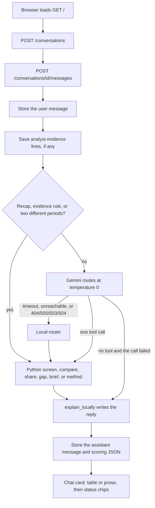

# Sky Scout

Sky Scout answers renovation questions for a firm investing in U.S. airport modernization. Public aviation files are stored in SQLite. Python computes every figure. The chat at [http://127.0.0.1:8000/](http://127.0.0.1:8000/) shows that result. The API reference is at [http://127.0.0.1:8000/docs](http://127.0.0.1:8000/docs).

A missing fact stays missing. It is not stored or spoken as zero. FAA, IATA, ICAO, BTS, and OurAirports identifiers are separate codes. Live traffic, weather, runway count, runway length, airport size, and passenger growth do not establish capacity or profitability. Profitability is claimed only from a complete analyst cash-flow schedule.

Python 3.12 or newer is required. This machine runs 3.13.

## Run

```bash
python -m venv .venv
source .venv/bin/activate
pip install -r requirements.txt
uvicorn app.main:app --reload
```

Copy `.env.example` to `.env`. The database file is `data/sky-scout.db`.

The airport catalog downloads on first startup, then refreshes in the background once a day. FAA enplanements, the latest stored BTS on-time month, and the previous calendar year of BTS T-100 load in the background after the site opens. A question uses whatever is already stored. A later start skips a file whose source URL is already recorded. `Application startup complete` means the site is open. The health field `datasets` stays `loading` until that background load finishes.

- Live aircraft positions work without OpenSky credentials. Arrivals and departures return 503 until `OPENSKY_CLIENT_ID` and `OPENSKY_CLIENT_SECRET` are set.
- Set `GEMINI_API_KEY` so Gemini can route a question. Create the key in Google AI Studio. The free tier may use those questions to improve Google's products. The default model is `gemini-3.8-flash`. If that call fails, the app tries `gemini-3.5-flash-lite`, then `gemini-flash-lite-latest`, then a local router. Python writes the reply in every case.
- Project costs and cash-flow schedules stay in the local database. They are sent to Gemini only when `ALLOW_PROJECT_COSTS_TO_MODEL=true`.

Reload a file by hand:

```bash
curl -X POST http://127.0.0.1:8000/sources/faa/enplanements
curl -X POST "http://127.0.0.1:8000/sources/bts/ontime?year=2026&month=8"
```

T-100 comes from the BTS download form, not PREZIP. A failed download keeps the last good rows and writes no zero.

## What the loaded store answers

These are the measured replies with the files now in `data/sky-scout.db`. A later import can change the figures. The chat prints one decimal place.

**Which airports in New England are strong candidates for terminal expansion?**

There is no opportunity rank. Passenger history is on file for 2020–2025, and constraint or intervention evidence is missing, so the result is a demand-growth watchlist. Strongest growth first: Tweed New Haven (HVN) 90.8, Burlington (BTV) 74.3, Rhode Island T. F. Green (PVD) 71.8, then Martha's Vineyard, Boston Logan, Bangor, Cape Cod Gateway, Portland, Worcester, Presque Isle, and the remaining New England peers with six annual years. Hanscom (BED), New Bedford (EWB), and Newport (NPT) are insufficient because they do not have six years. New England is Connecticut, Maine, Massachusetts, New Hampshire, Rhode Island, and Vermont. Territories are excluded. S is not profitability.

A rank for one airport appears only after that same message names the airport and supplies all three of a bottleneck, an intervention, and `capacity mapping: 80 | a written note`. R is 50 for suggestive analyst text. It is not a documented 75 or 100.

**Compare LA and Santa Ana airport congestion levels.**

August 2026, the latest complete BTS on-time month on file. Los Angeles International: 24.7 percent of reporting-carrier arrivals were delayed at least 15 minutes, mean 10.4 minutes. John Wayne (Santa Ana): 22.7 percent, mean 5.8 minutes. "LA" is LAX and "Santa Ana" is SNA. A live aircraft count is not used.

**What is the percentage of long-haul flights out of Anchorage airport?**

31.0 percent of geocoded 2025 departures from Ted Stevens Anchorage (ANC). Long-haul means a destination at least 3,000 statute miles away. Destinations without a distance are excluded, not counted as short-haul. Excluded destinations in that year: 0. Merrill Field is left out. The source is a full year of BTS T-100.

**What is the unmet flight demand in SFO airport and why?**

Unknown. San Francisco International is resolved, and the missing inputs are `unconstrained_demand` and `effective_capacity`. Unmet demand is unconstrained demand minus effective capacity for the same period and traffic definition. Served traffic, growth, delay, and a one-day flight count do not fill either input. No loaded file contains both.

**Compare Boston last year with LAX this year.**

Each airport keeps the year that was asked. Boston Logan in 2025: 21,021,153 FAA enplanements, and no BTS arrival-delay month for 2025. Los Angeles International in 2026: no annual enplanements, and August 2026 arrival delay of 24.7 percent, mean 10.4 minutes. Months are not averaged into a year. A missing figure is not zero. Different periods are not one congestion ranking.

**Summarize your recommendation, sources, assumptions, and biggest uncertainty in 150 words.**

After a scored answer in the same chat, this recaps that answer in 150 words or fewer: recommendation, sources, assumptions, and biggest uncertainty. As the first message, it does not invent a rank. It states that D, C, and R are not all present, names the FAA, BTS on-time, and T-100 coverage actually stored, repeats the demand-weight assumptions, and says the biggest uncertainty is the missing capacity mapping, renovation fit, unconstrained demand, and effective capacity. Profitability is not claimed.

**What evidence would distinguish a terminal bottleneck from a runway or airspace bottleneck?**

This states the evidence rule and does not score an airport. A terminal bottleneck needs gate or stand use against assessed usable capacity, passenger-processing throughput against an assessed operating limit, or published evidence that the terminal is binding. A runway bottleneck needs peak movements against a credible runway operating capacity. Runway count, length, and annual traffic do not establish it. An airspace bottleneck is an operating restriction. Physical expansion is not assumed to change regulatory limits. Delays and congestion do not name the binding facility. Without a declared metric, denominator, period, and source, C is not calculated.

## Chat

The page is `app/chat/index.html`. It is read on every `GET /`, so a layout change does not need a server restart. A Python change does.

- Enter sends. Shift+Enter adds a line. The button label is Send.
- New chat starts an empty conversation.
- Opening prompts send the four sample questions.
- Lists of airports and scores render as tables. When a table is shown, the same rows are not repeated as prose. The reason and status stay under the table.
- Read aloud speaks the text on the card. Answers are silent unless Read answers is turned on for the browser session. Record fills the question with this browser's speech recognition and then sends it.
- The layout fits a narrow phone: stacked prompts, a composer that stays on screen, and score tables that wrap instead of scrolling the page sideways.

Analyst evidence can be typed in the same message as a question:

```text
Bottleneck: the note
Intervention: the note
Capacity mapping: 80 | the written mapping
Project cost: 400 million USD
Cash flows:
discount_rate: 0.1
currency: USD
inflation: nominal
perspective: airport sponsor
2027,10,2,4,1,20,1
2028,12,3,4,1,0,0
```

Bottleneck, intervention, and capacity mapping attach only when the message names exactly one airport code. Project cost and cash flows stay on the conversation. They are never copied into observations. NPV is the sum of each year's free cash flow discounted from the first year. An incomplete schedule stays unclaimed.

## How a question becomes an answer



1. The page creates a conversation and keeps its id. Send, Enter, a prompt chip, or the end of a recording posts the question text.
2. The server stores that user message, then saves any bottleneck, intervention, capacity mapping, project cost, or cash-flow block. Costs are removed from the text Gemini sees unless `ALLOW_PROJECT_COSTS_TO_MODEL=true`.
3. A recap, a bottleneck-evidence question, or a comparison that names a different period for each airport is routed in Python. Those phrases are `summarize`, `what evidence` plus `bottleneck`, and `compare A last year with B this year`. "Last year" and "this year" are resolved from the current UTC year.
4. Anything else goes to Gemini with only these tools: `screen`, `compare`, `share`, `gap`, `brief`, and `method`. There is no web search and no calculator. If Gemini is unreachable, times out, or returns 404, 500, 503, or 504, the local router chooses the tool. If no tool is chosen, the reply says the question was not scored.
5. A screen that omits the project type keeps the project type from the previous screen in the conversation, or from the words "terminal" or "runway" in the latest question.
6. `run_tool` reads SQLite and returns scoring JSON. It does not call Gemini. `explain_locally` turns that JSON into the sentences the user sees. The model does not rewrite the numbers.
7. The assistant message and the JSON are stored. The browser builds tables from `ranked`, demand-growth rows, insufficient-data rows, congestion values, or per-airport periods. Other answers stay as prose. Read aloud uses the text on that card.

## Codebase

| Path | Role |
| --- | --- |
| `app/main.py` | FastAPI app, startup catalog, background FAA and BTS load, snapshot purge |
| `app/config.py` | Settings and the FAA, on-time, and T-100 source URLs |
| `app/db.py`, `app/models.py` | SQLite, airports, identifiers, observations, snapshots, dataset syncs, conversations, messages, analyst evidence |
| `app/api/routes.py` | Health, airport search, traffic, arrivals, departures, weather, observations, snapshots |
| `app/api/stats_routes.py` | Manual FAA and BTS reloads |
| `app/api/chat_routes.py` | The page, conversations, and messages |
| `app/chat/index.html` | The chat page |
| `app/chat/agent.py` | One turn: evidence, route, score, explain |
| `app/chat/gemini.py` | Gemini routing and the fallback model list |
| `app/chat/local.py` | Router used when Gemini is absent, and the recap, method, and two-period patterns |
| `app/scoring/service.py` | `screen`, `compare`, `share`, `gap`, `brief`, `method` |
| `app/scoring/formulas.py` | Demand weights, average-rank normalization, and S |
| `app/scoring/geography.py` | Census regions, New England, and the territory rule |
| `app/scoring/explain.py` | The user-facing sentences |
| `app/scoring/evidence.py` | Analyst evidence and redaction |
| `app/scoring/finance.py` | Capacity-mapping parse and NPV |
| `app/services/catalog.py` | OurAirports import and airport lookup |
| `app/services/stats.py` | FAA enplanements, BTS on-time, and BTS T-100 |
| `app/services/live.py` | OpenSky traffic, arrivals, and departures |
| `app/sources/` | HTTP clients for OurAirports, OpenSky, and Aviation Weather |
| `app/mcp/` | The same scoring functions for Cursor |
| `.cursor/skills/us-airport-renovation-opportunity-ranking/SKILL.md` | The ranking method, copied verbatim |
| `.cursor/mcp.json` | Cursor command for the MCP server |
| `tests/` | Service, scoring, chat, and data-service end-to-end tests |

`screen` ranks a region and project. D needs six comparable annual FAA enplanements and a cohort of at least two. Weights are 0.40, 0.25, 0.20, and 0.15. C is a stored capacity-pressure value from 0 to 100 with a coverage note, or an analyst capacity mapping on that airport. R is 50 only when that airport has both a bottleneck and an intervention. S is `100 * (D/100)^0.40 * (C/100)^0.35 * (R/100)^0.25`. Confidence stays low and is not multiplied into S.

`compare` scores BTS arrival delay for one month. With a separate period on each airport, it reports FAA enplanements for a calendar year and the loaded delay months in that year, each labeled.

`share` scores the long-haul share for one airport. A year uses T-100. A `YYYY-MM-DD` value uses a stored OpenSky departure day.

`gap` for unmet demand always returns unknown and names the two missing inputs.

`brief` and `method` do not create a new rank.

## Cursor

```bash
python -m app.mcp
```

`.cursor/mcp.json` points Cursor at the project virtualenv. The tools are `screen`, `compare`, `share`, `gap`, `brief`, `method`, `search_airports`, `get_observations`, and `record_analyst_evidence`. The last one is the only write. Each scoring tool returns the same JSON as the in-process function.

## Stored metrics

- `aircraft_in_bbox` is a receiver sample near one airport, about 50 km, cached for 60 seconds. It is not passengers, seats, movements, or congestion. An empty OpenSky state list is measured 0. A missing state list is null.
- `arrival_flights` and `departure_flights` count OpenSky flights for one airport and window. The default window is yesterday UTC. A span longer than two days is rejected. Credentials are required. A 404 or empty body is null, not zero. The window is cached for 24 hours.
- METAR is cached for 60 minutes and TAF for 6 hours. Both are `context_only`.
- `enplanements` are FAA passenger boardings for one calendar year. They are not doubled and they are not movements.
- `arrival_delay_share` and `arrival_delay_mean_minutes` are BTS reporting-carrier arrival delay for one month.
- `long_haul_departures`, `geocoded_departures`, and `unknown_destination_departures` are BTS T-100 segment counts.

Raw snapshots older than 30 days are deleted. Observations and the catalog stay. Upstream data calls time out at 15 seconds. Dataset downloads time out at 180 seconds. A 429 waits for `Retry-After` once. Logs omit the OpenSky client secret, access token, and API keys.

## Tests

```bash
pytest
```

The tests stub OurAirports, OpenSky, Aviation Weather, and the model. They do not call those services. Chat tests check that the reply numbers match the scoring module.
