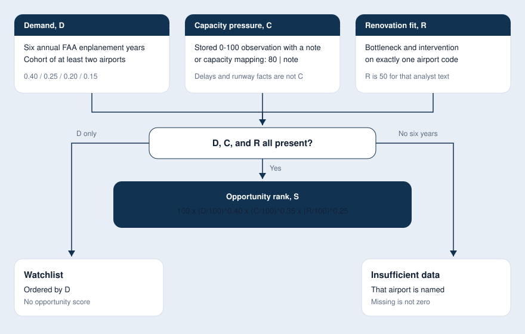
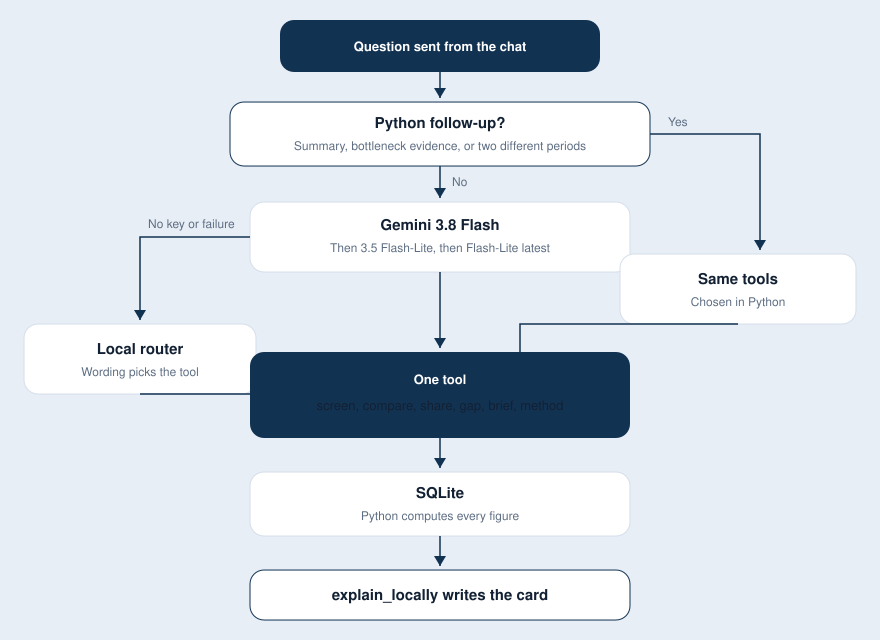
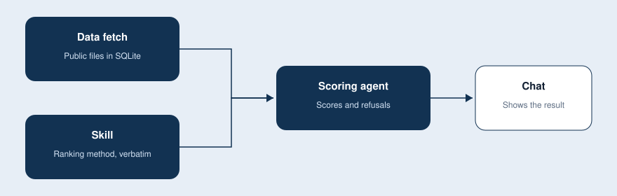

# Sky Scout design

Sky Scout screens U.S. airports for renovation questions. Public files sit in SQLite. Python computes every figure. The chat explains that result. A missing fact stays missing.

The method is the ranking skill at `.cursor/skills/us-airport-renovation-opportunity-ranking/SKILL.md`, copied verbatim. This note describes how the program applies that skill. It does not replace it.

## 1. Scoring methodology

Territory on every ranking answer is U.S. states and the District of Columbia. Territories are excluded. The peer set for a screen is scheduled commercial-service airports in the named Census states. New England is Connecticut, Maine, Massachusetts, New Hampshire, Rhode Island, and Vermont.

Four scores follow the skill. A rank exists only when D, C, and R are all present for one airport and one project.

**Demand, D.** Six comparable annual FAA enplanement years, and a cohort of at least two airports. The window is the latest year on file and the five years before it. Inside that cohort, each component is turned into a 0–100 score by ascending average rank. Ties share the average rank. The weakest peer scores 0.

D = 0.40 long-term growth + 0.25 recent growth + 0.20 absolute increase + 0.15 growth consistency.

Long-term growth is the compound annual rate over the five intervals. Recent growth is the latest year against the year before it. Absolute increase is the change in boardings across the window. Consistency is the share of year-to-year increases. Weights are design assumptions. There is no reduced model when a year is missing. Fewer than six years means that airport is insufficient data.

**Capacity pressure, C.** A number from 0 to 100 only when the airport has a stored capacity-pressure observation with a written coverage note, or an analyst line `capacity mapping: 80 | the written note` for that airport. An observation wins if both exist. Delays, runway count, runway length, and annual traffic do not become C.

**Renovation fit, R.** 50 only when that airport has both an analyst bottleneck and an analyst intervention. That is suggestive evidence. It is not a documented 75 or 100. If the message names more than one airport code, the note is not attached.

**Opportunity, S.** For an eligible pair:

S = 100 × (D/100)^0.40 × (C/100)^0.35 × (R/100)^0.25

S is not a probability, a return, or a forecast of new passengers. Confidence stays low and is not multiplied into S. Incremental passengers and movements stay unknown unless a real capacity and demand pair is on file. Profitability is claimed only when a complete analyst cash-flow schedule is present: discount rate, currency, inflation convention, investor perspective, and each year of aeronautical revenue, non-aeronautical revenue, operating costs, taxes, capex, and working capital. NPV discounts each year's free cash flow from the first year. A project cost alone does not claim profitability.

If passenger history exists and C or R does not, the airport stays on a demand-growth watchlist. The watchlist is ordered by D. It is not a rank.

Three other measured questions use the same store and do not produce S:

- **Congestion** is the BTS reporting-carrier share of arrivals delayed at least 15 minutes, plus the mean delay minutes, for one complete month. "LA" resolves to LAX and "Santa Ana" to SNA. Other scheduled commercial airports in that city are named and left out. A live aircraft count is not congestion. If each airport is given its own year, FAA boardings and the loaded delay months are reported separately and are not averaged into one ranking.
- **Long-haul share** is departures whose destination is at least 3,000 statute miles away, divided by geocoded departures. Unknown destinations are excluded. A year uses BTS T-100. One calendar day uses a stored OpenSky departure list and is labeled as a one-day sample.
- **Unmet demand** is unconstrained demand minus effective capacity for the same period and the same traffic definition. The function returns unknown and names whichever of those two inputs is missing. Growth, delay, and served traffic do not fill the gap.

A recap and a bottleneck-evidence question do not calculate a new score. The recap repeats the previous scored answer, or, when the chat has none, the coverage and rules on file. The evidence question states how a terminal, runway, or airspace bottleneck would have to be shown before C can be assigned.

## 2. Key tradeoffs

**Python writes the numbers.** Gemini only chooses the tool. A second model pass that rewrote the explanation was left out, so a fluent paragraph cannot replace a missing input or round a score on its own. The cost is that the prose is fixed by `explain_locally` and will not restyle itself for each reader.

**Unknown stays unknown.** The skill forbids a reduced demand model, a capacity score inferred from delays or runways, and an unmet-demand figure built from enplanements, load factor, or delay. The product therefore refuses some questions that a reader might expect to have a number. SFO unmet demand is the standing case: the two required inputs are not in any loaded file.

**One process and one SQLite file.** The catalog, observations, chats, and analyst notes share `data/sky-scout.db`. That keeps a laptop deployment small. A second writer against the same file will wait on the database lock. Public downloads run in the background after startup so the site opens while files arrive. A question scores whatever is already stored.

**Analyst text can finish C and R, and it is labeled as analyst text.** A capacity mapping and a bottleneck-plus-intervention pair can complete a rank. They are never copied into observations as measured API data. R stops at 50 for that kind of note. Project costs and cash-flow schedules stay on the conversation. By default they are removed from the text sent to Gemini. NPV can still be computed locally from a complete schedule.

**Identifiers are not merged.** An OurAirports ident, an ICAO code, an IATA code, an FAA location id, and a BTS code can refer to the same airport only through an explicit mapping. FAA boardings are matched on the FAA location id. That drops some rows that a looser join would have kept, and it avoids assigning one airport's passengers to another.

**Congestion is one month.** Comparing "last year" with "this year" does not invent an annual delay rate. Each side shows the annual boardings on file and the delay months on file. The comparison is honest and it is not a single ranking.

## 3. Where AI is used

AI is used in one place: routing.

When `GEMINI_API_KEY` is set, Gemini 3.8 Flash receives the conversation at temperature 0 and may call one tool: `screen`, `compare`, `share`, `gap`, `brief`, or `method`. It has no web search and no calculator. If that model is unavailable, the client tries `gemini-3.5-flash-lite` and then `gemini-flash-lite-latest`. If the call times out, cannot be reached, or returns 404, 500, 503, or 504, a local router picks the tool from the wording. With no key, the local router is used from the start.

A few questions are routed in Python before Gemini sees them: a request to summarize the recommendation, a question about how a terminal bottleneck differs from a runway or airspace bottleneck, and a comparison that names a different period for each airport.

The model does not compute D, C, R, S, a delay percentage, a long-haul share, an unmet-demand number, or an NPV. After the tool returns JSON, `explain_locally` writes the sentences on the screen. Read aloud is the browser's speech API reading that card. It does not call a model.

Cursor can call the same functions through the MCP server. Cursor's own model talks to the user. The MCP tools return the scoring JSON. They do not let the model invent a rank.

Project-cost amounts and cash-flow schedules are withheld from Gemini unless `ALLOW_PROJECT_COSTS_TO_MODEL=true`. Bottleneck notes, intervention notes, and capacity mappings are part of the question text the router sees.

## 4. How the program was built

Each part was built for one job, then the next part called it. The order was the data store, the skill, the scoring agent, and the chat application.

**Data fetch.** The first phase stored public data and served it over HTTP, with no ranking and no chat. OurAirports supplies the catalog and the identifier schemes. OpenSky supplies a short-lived aircraft count near one airport, and arrivals or departures when credentials are set. Aviation Weather supplies METAR and TAF, marked as context only. Later, the same observation tables gained FAA annual enplanements, BTS on-time arrival delay, and BTS T-100 segments, because demand, congestion, and long-haul share need those files. Downloads are skipped when that source URL is already stored. A failed download keeps the last good rows.

**Skill.** The ranking skill was copied into the repo verbatim and left as the method. Scoring code implements its eligibility rules, weights, and refusals. The skill text is not paraphrased into a second policy.

**Agent.** The scoring module is the agent that owns the numbers: `screen`, `compare`, `share`, and `gap`, plus a recap and the bottleneck-evidence note. Analyst evidence, capacity mapping, and NPV were added here so a rank and a profitability claim can be completed from what an analyst types, under the skill's limits. Gemini, and the local router behind it, only select which function runs. The MCP server is a second door to those same functions for Cursor.

**Application.** The last phase is the product around that agent. FastAPI serves the chat page, stores each conversation, and returns the explanation plus the scoring JSON. The page turns ranked lists, growth lists, insufficient-data lists, congestion, and mixed-period comparisons into tables, and reads the visible card aloud only when asked. New chat, Enter to send, and the phone layout are part of this phase. The page does not calculate.

## 5. Demo

[sky-scout-demo.mp4](sky-scout-demo.mp4)
